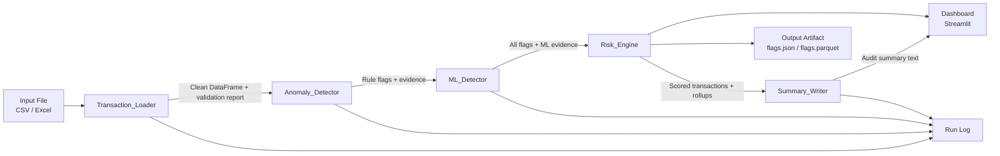

# Design Document

## Overview

The AI Audit and Risk Analytics Tool is a Python application that ingests a CSV or Excel file of financial journal entries, runs a layered detection pipeline (rule-based checks followed by an Isolation Forest ML model), scores risk at three levels (transaction, account, approver), and produces a plain-English audit summary. Every flagged item carries structured evidence so findings are fully explainable. A Streamlit dashboard exposes interactive filtering, charts, and drill-down into individual flags.

The tool is designed to run entirely on a local laptop from a single Python environment. It has no mandatory network dependency except for the optional OpenAI API call for the narrative summary; when that call is unavailable the tool substitutes a deterministic template.

### Key Design Goals

- **Explainability first**: every flag records the rule/model name, threshold, and the exact numeric evidence that triggered it.
- **Auditability**: a structured run log captures input metadata, row counts, per-rule flag counts, skipped checks with reasons, and the AI prompt/response verbatim.
- **Layered detection**: rule-based checks run first so their flag rate can inform the ML contamination parameter; each layer catches different anomaly classes.
- **Performance**: vectorised pandas operations and scikit-learn batch scoring target ≤120 seconds for 100,000 transactions.
- **Testability**: a reproducible synthetic-data generator with planted anomalies enables recall tests for every detection rule.

---

## Architecture

The tool follows a linear pipeline with clearly separated modules. Data flows from left to right; the run log and output artifact are written at the end.



### Module Responsibilities

| Module | Responsibility |
|--------|---------------|
| `transaction_loader.py` | Read, type-coerce, deduplicate, and validate the input file |
| `anomaly_detector.py` | Apply all five rule-based checks and emit structured flags |
| `ml_detector.py` | Train Isolation Forest and emit ML flags with feature scores |
| `risk_engine.py` | Assign transaction risk scores; produce account and approver rollups |
| `summary_writer.py` | Call OpenAI API (or fallback template) to produce ≤400-word summary |
| `dashboard.py` | Streamlit app: filters, charts, flagged-transaction table, drill-down |
| `data_generator.py` | Synthetic transaction generator with planted-anomaly support |
| `run_log.py` | Structured JSON run log writer used by all modules |
| `config.py` | Centralised threshold and configuration constants |

### Execution Entry Points

- **CLI pipeline**: `python main.py --input transactions.csv` — runs the full pipeline and writes outputs to `output/`.
- **Dashboard**: `streamlit run dashboard.py` — loads the most recent (or a specified) output artifact.
- **Generator**: `python data_generator.py --count 10000 --seed 42 --output data/synthetic.csv`

---

## Components and Interfaces

### 1. Transaction_Loader (`transaction_loader.py`)

**Public interface**

```python
def load(path: str | Path, config: Config) -> tuple[pd.DataFrame, ValidationReport]:
    """
    Load a CSV or Excel file, coerce types, deduplicate, and validate.

    Returns:
        df              — cleaned DataFrame with columns:
                          tx_id (str), date (datetime.date), time (datetime.time),
                          account (str), amount (float), approver (str),
                          vendor (str), description (str)
        report          — ValidationReport dataclass
    Raises:
        MissingColumnsError — if required columns are absent
    """
```

**ValidationReport dataclass**

```python
@dataclass
class ValidationReport:
    rows_loaded: int
    rows_coerced: int           # rows where ≥1 field was coerced with raw value preserved
    rows_excluded: int          # rows dropped due to missing required fields
    duplicates_removed: int
    coercion_detail: list[dict] # [{row_index, field, raw_value, coerced_value}]
    exclusion_detail: list[dict]# [{row_index, reason}]
```

**Implementation notes**
- Use `pd.read_csv` / `pd.read_excel` with `dtype=str` for the initial read to avoid silent coercions.
- Validate required columns `{date, time, account, amount, approver, vendor, description}` immediately after load; raise `MissingColumnsError` with the list of missing names.
- Assign a stable `tx_id` as `sha256(row_as_string)[:12]` before any cleaning so IDs are deterministic across runs.
- Coerce `date` with `pd.to_datetime(..., errors='coerce')`, `amount` with `pd.to_numeric(..., errors='coerce')`, `time` with custom parsing accepting `HH:MM` and `HH:MM:SS`.
- Drop rows where `account`, `amount`, or `date` is null after coercion; record them in `exclusion_detail`.
- Identify exact duplicates (all original columns) with `df.duplicated(keep='first')` before assigning `tx_id`.

---

### 2. Anomaly_Detector (`anomaly_detector.py`)

**Public interface**

```python
def detect(df: pd.DataFrame, config: Config, run_log: RunLog) -> list[Flag]:
    """
    Run all rule-based anomaly checks.
    Returns a flat list of Flag objects; a single transaction may appear multiple times
    (once per triggered rule).
    """
```

**Flag dataclass**

```python
@dataclass
class Flag:
    tx_id: str
    rule: str           # e.g. "statistical_outlier"
    threshold: str      # human-readable, e.g. "|z| > 3.0"
    evidence: dict      # rule-specific key/value pairs
```

**Rule implementations**

| Rule | Key | Trigger | Evidence fields |
|------|-----|---------|----------------|
| Statistical outlier | `statistical_outlier` | `abs(z_score) > config.zscore_threshold` (default 3.0) | `z_score`, `account_mean`, `account_std`, `account_tx_count` |
| Benford deviation | `benford_deviation` | chi-square p-value < 0.05 on first-digit distribution | `chi2_statistic`, `p_value`, `per_digit_observed`, `per_digit_expected`, `per_digit_deviation` |
| Duplicate payment | `duplicate_payment` | same vendor + same amount within 7 calendar days | `paired_tx_id`, `date_gap_days`, `group_size` |
| Weekend posting | `weekend_posting` | `date.weekday() >= 5` | `day_of_week`, `posting_date` |
| After-hours posting | `after_hours_posting` | `time < config.business_start` or `time > config.business_end` | `posting_time`, `business_hours_window` |
| Round amount | `round_amount` | `amount % config.round_threshold == 0` | `amount`, `threshold` |

**Statistical outlier implementation**

```python
# Group by account; skip groups with < config.min_account_tx (default 10)
stats = df.groupby("account")["amount"].agg(["mean", "std", "count"])
df = df.join(stats, on="account", rsuffix="_acct")
df["z_score"] = (df["amount"] - df["mean"]) / df["std"].replace(0, np.nan)
flagged = df[df["z_score"].abs() > config.zscore_threshold]
```

**Benford test implementation**

- Computed at the **dataset level** (not per account) for sufficient sample size.
- Extract first digit of each positive amount: `first_digit = int(str(abs(amount))[0])`.
- Expected frequencies: `P(d) = log10(1 + 1/d)` for d in 1..9 ([Benford's Law](https://en.wikipedia.org/wiki/Benford%27s_law)).
- Use `scipy.stats.chisquare(observed_counts, f_exp=expected_counts)`.
- If p-value < 0.05 emit a **single dataset-level flag** (not per-transaction) stored as a special record with `tx_id = "__dataset__"`.

**Duplicate payment implementation**

- Sort by `vendor`, `amount`, `date`.
- Use a self-join via `pd.merge_asof` on `date` within each `(vendor, amount)` group, with `tolerance=pd.Timedelta(days=7)`.
- Each matched pair produces two flags (one per transaction in the pair).

---

### 3. ML_Detector (`ml_detector.py`)

**Public interface**

```python
def detect(df: pd.DataFrame, rule_flags: list[Flag], config: Config, run_log: RunLog) -> list[Flag]:
    """
    Train Isolation Forest on the transaction feature matrix and emit ML flags.
    contamination is set to max(rule_flag_rate, 0.01) where rule_flag_rate =
    len(set(f.tx_id for f in rule_flags)) / len(df).
    Returns Flag objects with rule = "ml_isolation_forest".
    """
```

**Feature engineering**

| Feature | Derivation |
|---------|-----------|
| `amount_log` | `np.log1p(abs(amount))` |
| `hour_of_day` | `time.hour + time.minute / 60` |
| `day_of_week` | `date.weekday()` (0=Mon … 6=Sun) |
| `is_weekend` | `int(day_of_week >= 5)` |
| `account_enc` | `LabelEncoder` on `account` |
| `vendor_enc` | `LabelEncoder` on `vendor` |
| `approver_enc` | `LabelEncoder` on `approver` |
| `amount_z_norm` | `(amount - global_mean) / global_std` |

**Isolation Forest configuration**

```python
IsolationForest(
    n_estimators=200,
    contamination=max(rule_flag_rate, 0.01),
    random_state=config.random_state,  # default 42
    n_jobs=-1,
)
```

**Evidence extraction**

- `anomaly_score`: `model.decision_function(row)` (more negative = more anomalous).
- `feature_contributions`: difference between the row's feature vector and the global per-feature median, reported as `{feature_name: delta}` for the top 3 contributing features by absolute deviation.

**Skip condition**: fewer than 100 transactions → record skip in run log with reason.

---

### 4. Risk_Engine (`risk_engine.py`)

**Public interface**

```python
def score(
    df: pd.DataFrame,
    flags: list[Flag],
    config: Config,
) -> tuple[pd.DataFrame, pd.DataFrame, pd.DataFrame]:
    """
    Returns:
        tx_scores    — original df with columns: risk_score (0-100), score_breakdown (dict as JSON str)
        account_rollup
        approver_rollup
    """
```

**Rule severity weights** (configurable in `config.py`)

| Rule | Base points |
|------|------------|
| `statistical_outlier` | 30 |
| `benford_deviation` | 20 |
| `duplicate_payment` | 35 |
| `weekend_posting` | 10 |
| `after_hours_posting` | 15 |
| `round_amount` | 10 |
| `ml_isolation_forest` | 25 |

**Scoring algorithm**

1. For each transaction, sum the base points of all its flags.
2. Cap the raw sum at 100.
3. `score_breakdown` records `{rule: points}` per flag so the contribution of each rule is visible.
4. Transactions with no flags receive `risk_score = 0`.

**Rollup schema**

```python
# account_rollup columns:
account | tx_count | flag_count_by_rule (dict) | mean_risk_score | max_risk_score | is_small_sample (bool, True if tx_count < 5)

# approver_rollup columns:
approver | tx_count | flag_count_by_rule (dict) | mean_risk_score | max_risk_score | is_small_sample (bool)
```

---

### 5. Summary_Writer (`summary_writer.py`)

**Public interface**

```python
def write_summary(
    flags: list[Flag],
    tx_scores: pd.DataFrame,
    account_rollup: pd.DataFrame,
    approver_rollup: pd.DataFrame,
    config: Config,
    run_log: RunLog,
) -> str:
    """
    Returns the plain-English audit summary (≤400 words).
    Logs the AI prompt and response verbatim to run_log.
    Falls back to deterministic template on API failure.
    """
```

**AI call implementation**

- Use `openai.chat.completions.create` with model `gpt-4o-mini` (configurable), `max_tokens=600`, `timeout=30`.
- The prompt is a structured string containing: top 5 risks by aggregated `risk_score`, their flag types, and their evidence values.
- If `OPENAI_API_KEY` is not set or the call raises any exception (timeout, rate limit, auth error), fall back to the deterministic template.
- Both the prompt text and the raw API response (or fallback indicator) are written to the run log.

**Deterministic fallback template**

```
Audit Summary (auto-generated)
Run date: {date}
Transactions analysed: {tx_count} | Flagged: {flag_count} ({flag_pct}%)

Top risks:
1. {rule_1}: {count_1} transactions, highest risk score {max_score_1}
   Evidence: {evidence_summary_1}
...

Limitations: This analysis covers {rule_list} rule-based checks and an exploratory
Isolation Forest model. It does not constitute a complete audit and should be
reviewed by a qualified auditor.
```

**Limitations statement** (always included)

> This analysis covers rule-based checks (statistical outlier, Benford's law, duplicate payments, weekend/after-hours postings, round amounts) and an exploratory Isolation Forest model. These checks are heuristic indicators; they do not prove fraud or error. All flagged items require auditor judgement before conclusions are drawn.

---

### 6. Dashboard (`dashboard.py`)

**Layout**

```
┌─ Sidebar ───────────────────────────────────────────────────────┐
│  Date range slider          Account multiselect                  │
│  Approver multiselect       Vendor multiselect                   │
│  Rule name multiselect      Min risk score slider                │
└─────────────────────────────────────────────────────────────────┘
┌─ Main area ─────────────────────────────────────────────────────┐
│  KPI row: total flagged | unique accounts | top approver risk    │
│  Row 1: Flag counts by rule (bar) | Risk dist by account (bar)  │
│  Row 2: Amount over time with flagged points highlighted (line)  │
│  Flagged transactions table (st.dataframe with on_select)        │
│  [When row selected] Evidence expander per flag                  │
│  Audit summary text (st.expander)                                │
│  [Empty state message when no rows match filters]                │
└─────────────────────────────────────────────────────────────────┘
```

**Data loading**

- `@st.cache_data` on the function that loads the output artifact, keyed by file path and mtime.
- Accept a `--artifact` CLI argument or a file-upload widget so reviewers can load any run's output.

**Chart library**: `plotly.express` via `st.plotly_chart` for interactive hover tooltips.

---

### 7. Data Generator (`data_generator.py`)

**Public interface**

```python
def generate(
    count: int,
    seed: int,
    anomalies: list[AnomalySpec] | None = None,
) -> pd.DataFrame:
    """
    Returns a synthetic transaction DataFrame.
    Identical seed + count + anomalies produces identical output.
    """
```

**AnomalySpec**

```python
@dataclass
class AnomalySpec:
    type: Literal[
        "statistical_outlier", "benford_violation", "duplicate_payment",
        "weekend_posting", "after_hours_posting", "round_amount",
        "ml_pattern"      # patterned but rule-undetectable
    ]
    count: int            # number of anomalies to plant
    params: dict          # type-specific parameters
```

**Base data characteristics**

- Accounts: 20 unique accounts with normally distributed amounts per account (mean 5,000–50,000, std 10–20% of mean).
- Vendors: 50 unique vendors, randomly assigned.
- Approvers: 10 unique approvers.
- Dates: uniform random within a configurable 12-month window.
- Times: normally distributed around 10:00–16:00 on weekdays.

---

### 8. Run Log (`run_log.py`) and Output Artifact

**Run log** (`output/run_<timestamp>.json`)

```json
{
  "run_id": "<uuid>",
  "timestamp": "<ISO-8601>",
  "input_file": "<path>",
  "config_snapshot": {...},
  "row_counts": {"loaded": 0, "coerced": 0, "excluded": 0, "duplicates_removed": 0},
  "rule_flag_counts": {"statistical_outlier": 0, ...},
  "skipped_checks": [{"check": "zscore", "account": "ACC-01", "reason": "fewer than 10 transactions"}],
  "ml_skip_reason": null,
  "ai_prompt": "<verbatim>",
  "ai_response": "<verbatim or 'FALLBACK'>",
  "summary_text": "<final summary>"
}
```

**Output artifact** (`output/flags_<run_id>.parquet`)

One row per flag. Columns: `run_id`, `tx_id`, `rule`, `threshold`, `evidence` (JSON string), `risk_score`, `score_breakdown` (JSON string).

Parquet is chosen for efficient columnar reads by the dashboard; a JSON fallback (`flags_<run_id>.json`) is also written for portability.

---

## Data Models

### Transaction (internal DataFrame schema)

| Column | Dtype | Notes |
|--------|-------|-------|
| `tx_id` | `str` | SHA-256 hash prefix of original row |
| `date` | `datetime64[ns]` | Coerced from input `date` column |
| `time` | `object` (Python `time`) | Stored as Python `datetime.time` |
| `account` | `str` | |
| `amount` | `float64` | Signed; may be negative (credits) |
| `approver` | `str` | |
| `vendor` | `str` | |
| `description` | `str` | |

### Flag

```python
@dataclass
class Flag:
    tx_id: str
    rule: str
    threshold: str
    evidence: dict
```

### Config

```python
@dataclass
class Config:
    # Statistical outlier
    zscore_threshold: float = 3.0
    min_account_tx: int = 10

    # Benford
    benford_min_count: int = 100
    benford_significance: float = 0.05

    # Duplicate payment
    duplicate_window_days: int = 7

    # Timing
    business_start: datetime.time = datetime.time(8, 0)
    business_end: datetime.time = datetime.time(18, 0)

    # Round number
    round_threshold: float = 1000.0

    # ML
    min_ml_tx: int = 100
    random_state: int = 42

    # Risk scoring weights (rule -> base points)
    rule_weights: dict[str, int] = field(default_factory=lambda: {
        "statistical_outlier": 30,
        "benford_deviation": 20,
        "duplicate_payment": 35,
        "weekend_posting": 10,
        "after_hours_posting": 15,
        "round_amount": 10,
        "ml_isolation_forest": 25,
    })

    # Summary
    openai_model: str = "gpt-4o-mini"
    openai_max_tokens: int = 600
    openai_timeout: int = 30
    top_risks_in_summary: int = 5
    summary_max_words: int = 400
```

Config is loaded from `config.yaml` at startup; defaults apply when keys are absent.

### RollupRow

```python
@dataclass
class RollupRow:
    group_key: str          # account name or approver name
    tx_count: int
    flag_count_by_rule: dict[str, int]
    mean_risk_score: float
    max_risk_score: float
    is_small_sample: bool   # True if tx_count < 5
```

---

## Correctness Properties

*A property is a characteristic or behavior that should hold true across all valid executions of a system — essentially, a formal statement about what the system should do. Properties serve as the bridge between human-readable specifications and machine-verifiable correctness guarantees.*

### Property 1: Loading preserves unique rows

*For any* valid CSV or Excel input, the DataFrame produced by `Transaction_Loader` SHALL contain exactly the number of distinct (non-duplicate) rows present in the input, and the `ValidationReport` SHALL record the number of duplicates removed.

**Validates: Requirements 1.1, 1.6**

### Property 2: Validation report exactness

*For any* input row that is coerced or excluded, the `ValidationReport` SHALL contain exactly one corresponding detail entry (with the raw value for coercions, and the reason for exclusions), and the reported counts of rows loaded, coerced, and excluded SHALL equal the actual counts.

**Validates: Requirements 1.2, 1.3, 1.5**

### Property 3: Statistical outlier flag and evidence consistency

*For any* account with at least `min_account_tx` transactions, the Anomaly_Detector SHALL flag exactly those transactions whose absolute z-score exceeds `zscore_threshold`, and each flag's evidence SHALL contain a `z_score` equal to `(amount - account_mean) / account_std` within floating-point tolerance, together with `account_mean` and `account_std`.

**Validates: Requirements 2.1, 2.2**

### Property 4: Benford deviation evidence completeness

*For any* dataset where the first-digit chi-square p-value is below `benford_significance`, the emitted `benford_deviation` flag SHALL carry evidence containing `chi2_statistic`, `p_value`, `per_digit_observed`, and `per_digit_expected`.

**Validates: Requirements 3.1, 3.2**

### Property 5: Duplicate payment flag symmetry and evidence

*For any* pair of transactions sharing the same vendor and amount posted within `duplicate_window_days` of each other, the Anomaly_Detector SHALL flag both members of the pair, and each flag's evidence SHALL contain the paired transaction identifier and the posting-date gap. *For any* pair posted more than 7 days apart, neither member SHALL be flagged by this rule.

**Validates: Requirements 4.1, 4.2**

### Property 6: Timing flag exactness

*For any* transaction whose posting date falls on a weekend, `weekend_posting` SHALL be emitted and no weekday transaction SHALL receive it; *for any* transaction whose time is outside the configured business-hours window, `after_hours_posting` SHALL be emitted, and transactions within the window SHALL NOT receive it; each timing flag SHALL carry `day_of_week` or `posting_time` as evidence.

**Validates: Requirements 5.1, 5.2, 5.3, 5.4**

### Property 7: Round amount flag completeness

*For any* transaction amount that is an exact multiple of the configured round-number threshold, the Anomaly_Detector SHALL emit a `round_amount` flag whose evidence contains the amount and the threshold, and no non-multiple amount SHALL receive this flag.

**Validates: Requirements 6.1, 6.2, 6.3**

### Property 8: ML flag threshold consistency

*For any* transaction whose Isolation Forest `decision_function` score is below the model's decision threshold, the ML_Detector SHALL emit an `ml_isolation_forest` flag whose evidence contains `anomaly_score` and `feature_contributions`, and transactions at or above the threshold SHALL NOT receive it.

**Validates: Requirements 7.2, 7.3**

### Property 9: Flag completeness

*For any* flag emitted by the Anomaly_Detector or ML_Detector, the Flag SHALL contain the rule or model name, a human-readable trigger threshold, and non-empty evidence.

**Validates: Requirements 8.1**

### Property 10: Run log completeness

*For any* run, the run log SHALL record the input file, timestamp, row counts, per-rule flag counts, and every skipped check with its reason.

**Validates: Requirements 8.2**

### Property 11: Evidence retrievability round-trip

*For any* flag recorded in the output artifact, loading the artifact and looking up the flag by `tx_id` and `rule` SHALL return the same evidence values without re-running the analysis, and all flags for the run SHALL be present in that single artifact.

**Validates: Requirements 8.3, 8.4**

### Property 12: Risk score bounded with exact breakdown

*For any* transaction with any combination of flags, the `risk_score` SHALL be in [0, 100], equal to `min(sum of per-flag contributions, 100)`, with `score_breakdown` containing one entry per flag; *for any* unflagged transaction, `risk_score` SHALL be exactly 0.

**Validates: Requirements 9.1, 9.2, 9.5**

### Property 13: Rollup correctness including small-sample groups

*For any* account or approver group, the rollup SHALL contain a row whose `mean_risk_score` and `max_risk_score` equal the arithmetic mean and maximum of the group's risk scores, with per-rule flag counts matching, and *for any* group with fewer than 5 transactions, `is_small_sample` SHALL be True.

**Validates: Requirements 9.3, 9.4, 9.6**

### Property 14: Summary bounded, limited, and traceable

*For any* run, the generated summary SHALL be at most 400 words, SHALL contain the limitations statement covering rule coverage and the exploratory ML layer, and every number appearing in the summary SHALL also appear in the run's computed output data.

**Validates: Requirements 10.1, 10.5, 10.6**

### Property 15: Generator reproducibility and schema

*For any* count and seed, the generator SHALL produce a DataFrame with the seven required columns, and two calls with identical count, seed, and anomaly specifications SHALL produce identical DataFrames.

**Validates: Requirements 12.1, 12.2**

---

## Error Handling

### Input errors

| Condition | Behaviour |
|-----------|-----------|
| File not found | `FileNotFoundError` with descriptive message; pipeline aborts |
| Unsupported file extension | `ValueError("Unsupported format: …")`; pipeline aborts |
| Required columns missing | `MissingColumnsError(missing_columns)`; pipeline aborts |
| All rows invalid / empty DataFrame after cleaning | `EmptyDatasetError`; pipeline aborts with count stats |
| Row coercion failure | Row coerced or excluded; recorded in `ValidationReport`; pipeline continues |

### Runtime errors

| Condition | Behaviour |
|-----------|-----------|
| Fewer than 10 transactions in an account | Z-score check skipped for that account; skip recorded in run log |
| Fewer than 100 positive amounts (Benford) | Benford test skipped; skip recorded in run log |
| Fewer than 100 total transactions (ML) | ML detection skipped; skip recorded in run log |
| OpenAI API failure (any exception) | Deterministic template summary used; fallback recorded in run log |
| OpenAI API key not set | Deterministic template summary used; noted in run log |
| Division by zero in z-score (zero std) | Account skipped for z-score; skip recorded |
| Duplicate amount/vendor group > 50 | Group size noted in evidence; all members flagged |

### Error propagation strategy

- Recoverable data-quality issues (bad rows, skipped checks) do not abort the pipeline; they are recorded and processing continues.
- Unrecoverable structural errors (missing file, missing columns, empty result) abort early with a clear user-facing message.
- All module-level exceptions are caught in `main.py` and logged to `stderr` as well as the run log.

---

## Testing Strategy

### Unit tests (`tests/unit/`)

Unit tests cover specific logic paths and edge cases for each module. They use `pytest` with `pytest-mock` for mocking external calls.

- **`test_transaction_loader.py`**: valid CSV, missing columns, coercion of non-numeric amounts, duplicate removal, empty file, Excel format.
- **`test_anomaly_detector.py`**: z-score computation, z-score skip for small account, Benford chi-square on known distribution, Benford skip for small count, duplicate detection with known pairs, weekend/after-hours boundary conditions, round-number detection with custom threshold.
- **`test_ml_detector.py`**: feature matrix construction, contamination rate derivation, skip condition, flag output structure, evidence field presence.
- **`test_risk_engine.py`**: score capping at 100, zero score for unflagged row, breakdown dict values, rollup mean/max computation, small-sample annotation.
- **`test_summary_writer.py`**: API call with mocked `openai` client, fallback on exception, limitations statement presence, number traceability.
- **`test_data_generator.py`**: seed reproducibility, planted anomaly presence, clean dataset false-positive ceiling.

### Property-based tests (`tests/property/`)

Uses [Hypothesis](https://hypothesis.readthedocs.io/) with the `hypothesis` library. Minimum 100 iterations per property (`@settings(max_examples=100)`).

Each test is tagged with a comment in the format:
`# Feature: ai-audit-risk-tool, Property N: <property_text>`

| Test file | Property validated |
|-----------|-------------------|
| `test_loading_round_trip.py` | Property 1: Loading preserves unique rows |
| `test_validation_report_exactness.py` | Property 2: Validation report exactness |
| `test_zscore_flag_and_evidence.py` | Property 3: Statistical outlier flag and evidence consistency |
| `test_benford_evidence_completeness.py` | Property 4: Benford deviation evidence completeness |
| `test_duplicate_symmetry.py` | Property 5: Duplicate payment flag symmetry and evidence |
| `test_timing_flag_exactness.py` | Property 6: Timing flag exactness |
| `test_round_amount_completeness.py` | Property 7: Round amount flag completeness |
| `test_ml_threshold_consistency.py` | Property 8: ML flag threshold consistency |
| `test_flag_completeness.py` | Property 9: Flag completeness |
| `test_run_log_completeness.py` | Property 10: Run log completeness |
| `test_evidence_round_trip.py` | Property 11: Evidence retrievability round-trip |
| `test_risk_score_bounded_breakdown.py` | Property 12: Risk score bounded with exact breakdown |
| `test_rollup_correctness.py` | Property 13: Rollup correctness including small-sample groups |
| `test_summary_bounded_traceable.py` | Property 14: Summary bounded, limited, and traceable |
| `test_generator_reproducibility.py` | Property 15: Generator reproducibility and schema |

Properties 10 and 11 involve file I/O and are tested at integration level in addition to property tests (using `tmp_path` fixtures).

### Integration / detection tests (`tests/integration/`)

Run the full pipeline on synthetic datasets produced by `data_generator.py`.

- **`test_statistical_outlier_recall.py`**: plant 20 extreme-amount anomalies in a 500-row dataset; assert ≥90% detection rate.
- **`test_benford_recall.py`**: plant 200 fabricated same-digit amounts; assert `benford_deviation` triggered in ≥90% of 10 seeded runs.
- **`test_duplicate_recall.py`**: plant 10 duplicate pairs; assert both members of every planted pair are flagged.
- **`test_timing_recall.py`**: plant weekend and after-hours entries; assert 100% detection (deterministic rules).
- **`test_round_amount_recall.py`**: plant exact multiples of 1,000; assert 100% detection (deterministic rule).
- **`test_ml_recall.py`**: plant 20 patterned but rule-undetectable anomalies; assert ≥75% detection.
- **`test_false_positive_ceiling.py`**: generate a clean 1,000-row dataset; assert `statistical_outlier`, `duplicate_payment`, and `round_amount` flag rate ≤5%.
- **`test_evidence_retrievability.py`**: run pipeline and reload artifact; assert all flags are retrievable with matching evidence.

### Test infrastructure

- `conftest.py` provides shared fixtures: `sample_df`, `config_default`, `planted_anomaly_df`, `mock_openai_client`.
- Tests use `tmp_path` for file I/O to avoid polluting the workspace.
- Property tests have `settings(max_examples=100)` applied globally via `conftest.py`.
